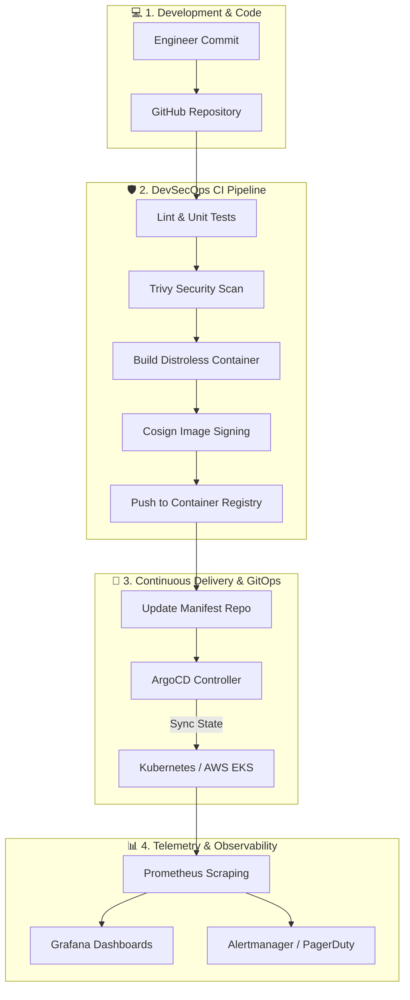

<div align="center">


### ☁️ Cloud & DevOps Learning Engineer | Aspiring SRE & Platform Engineer

*Bridging development and operations by building resilient infrastructure, automating CI/CD pipelines, and mastering cloud-native architectures.*

<br/>

[](https://github.com/sohamtaralkar1901)
[](https://www.linkedin.com/in/soham-taralkar/)
[](https://github.com/sohamtaralkar1901)
[](mailto:sohamtaralkar1901@gmail.com)
[](https://hub.docker.com/)


</div>

---

> [!NOTE]
> **Mission Statement:** Transforming from traditional development to modern **Cloud Native & DevOps Engineering**. Every project in this repository is built following industry-standard GitOps, Infrastructure as Code, and Shift-Left Security practices.

---

## ⚡ Interactive Terminal Preview

```bash
soham@cloud-workstation:~$ neofetch --devops
```
```yaml
Host:              Soham Taralkar (Cloud & DevOps Learning Engineer)
Current Focus:     Hands-on Multi-Cluster Kubernetes & Terraform Blueprints
Cloud Ecosystem:   AWS (Primary), GCP (Learning), Hybrid Bare-Metal
Daily Stack:       Linux (Ubuntu/Arch) · Docker · K8s · Terraform · Helm · Bash
CI/CD & GitOps:    GitHub Actions · ArgoCD · GitLab CI · Docker Compose
Observability:     Prometheus · Grafana · OpenTelemetry · Loki
Security (SecOps): Trivy · SonarQube · HashiCorp Vault · Infracost
Motto:            "Don't just run containers—orchestrate, secure, and monitor them."
Status:            Ready for Cloud / DevOps / SRE Internships & Entry-Level Roles 🚀
```

---

## 🧠 Continuous Learning & Competency Tracker

Here is an honest, real-time snapshot of my active upskilling roadmap in Cloud, DevOps, and Platform Engineering:

| Domain | Core Focus Areas | Progress | Status |
|:-------|:-----------------|:--------:|:------:|
| 🐧 **Linux & Networking** | Bash Scripting, Systemd, Process Mgmt, DNS, TCP/IP, IPtables, SSH | `██████████` 95% | **Solid** |
| 🐳 **Containers & Docker** | Multi-stage Dockerfiles, Distroless images, Docker Compose, Networking | `█████████░` 90% | **Proficient** |
| ⚙️ **CI/CD & Automation** | GitHub Actions workflows, Artifact caching, Reusable actions, Jenkins | `█████████░` 88% | **Proficient** |
| 🏗️ **Infrastructure as Code** | Terraform modules, State management, Terragrunt, Drift detection | `████████░░` 80% | **Active Lab** |
| ☸️ **Kubernetes (K8s)** | Pods, Deployments, Services, Ingress, Helm Charts, RBAC, CKA Prep | `████████░░` 78% | **Daily Focus** |
| ☁️ **AWS Cloud Architecture** | VPC, EKS, RDS, S3, IAM Least-Privilege, CloudWatch, SAA-C03 Prep | `███████░░░` 75% | **In Progress** |
| 📊 **Observability & SRE** | Prometheus metric scraping, Grafana dashboards, Alertmanager, SLOs | `███████░░░` 70% | **Active Lab** |
| 🔄 **GitOps & Mesh** | ArgoCD app-of-apps pattern, Canary rollouts, Istio service mesh | `██████░░░░` 62% | **Exploring** |
| 🛡️ **DevSecOps & FinOps** | Trivy vulnerability scanning, Infracost budgeting, Vault secrets | `██████░░░░` 60% | **Exploring** |

---

## 🚀 Hands-on Labs & Capstone Projects

Below are the end-to-end cloud and DevOps platforms I have architected and deployed during my practical learning journey:

### 1. [KubeScale — Multi-Tier GitOps Kubernetes Platform](https://github.com/sohamtaralkar1901)
> `🚀 Production-Grade Lab` · AWS EKS · ArgoCD · Helm 3 · Istio · Prometheus

```
[Developer Git Push] ➔ [GitHub Actions CI] ➔ [Image Push to ECR] ➔ [ArgoCD Sync] ➔ [AWS EKS Cluster]
```
- Built a multi-tenant microservices deployment on **AWS EKS** managed entirely through **GitOps (ArgoCD)**.
- Packaged full application stacks with custom **Helm 3 charts** supporting dev, staging, and prod overrides.
- Implemented **Istio Service Mesh** for mutual TLS (mTLS) pod-to-pod communication and canary traffic splitting.
- Configured dynamic ingress routing with **NGINX Ingress Controller** and **Cert-Manager** for automated Let's Encrypt TLS certs.

`Kubernetes` `AWS EKS` `ArgoCD` `Helm` `Istio` `Docker` `Terraform` `Prometheus`

---

### 2. [TerraForge — Automated Multi-Environment AWS IaC](https://github.com/sohamtaralkar1901)
> `🛠️ Infrastructure as Code` · Terraform · Terragrunt · AWS VPC · S3 Remote Backend

- Authored reusable, production-ready **Terraform modules** for bootstrapping resilient AWS Landing Zones.
- Configured secure remote state backend using **S3 bucket versioning** with **DynamoDB state locking**.
- Automated validation checks with **TFLint**, **tfsec** security analysis, and **Infracost** for PR cost projection.
- Provisions 3-tier networking: Public/Private subnets, NAT Gateways, Internet Gateway, and Route Tables.

`Terraform` `Terragrunt` `AWS` `VPC` `DynamoDB` `S3` `Infracost` `Bash`

---

### 3. [ZeroOps-Pipeline — End-to-End DevSecOps Continuous Delivery](https://github.com/sohamtaralkar1901)
> `🔒 Shift-Left DevSecOps` · GitHub Actions · Docker · Trivy · SonarQube · Slack Alerts

- Automated multi-stage CI/CD pipeline triggering on pull requests and pushes to main.
- Integrated **SonarQube** for static code quality analysis and test coverage gates.
- Built hardened container images using multi-stage builds and scanned them with **Trivy** for CVE vulnerabilities.
- Automatic image signing using **Cosign** before pushing to registry and notifying team via Slack Webhooks.

`GitHub Actions` `Docker` `Trivy` `SonarQube` `Cosign` `Security` `Slack API`

---

### 4. [ObservaPulse — Full-Stack Telemetry & Monitoring Stack](https://github.com/sohamtaralkar1901)
> `📈 SRE & Monitoring Lab` · Prometheus · Grafana · Node Exporter · Alertmanager · Loki

- Designed a centralized monitoring hub collecting cluster metrics and application logs.
- Configured custom **Grafana dashboards** visualizing Golden Signals: *Latency, Traffic, Errors, and Saturation*.
- Established **Alertmanager rules** sending real-time threshold notifications for CPU throttling, high memory, and container crash-loops.

`Prometheus` `Grafana` `Alertmanager` `Loki` `Node Exporter` `Linux` `Docker`

---

### 5. [CloudSaver — Serverless AWS Cost Optimizer & Janitor](https://github.com/sohamtaralkar1901)
> `💰 Cloud FinOps` · Python · AWS Lambda · Boto3 · CloudWatch Events

- Serverless Python automation bot executing daily via **AWS EventBridge (CloudWatch cron)**.
- Identifies and cleans up orphaned EBS volumes, idle Elastic IPs, and obsolete snapshots to minimize cloud waste.
- Automated scheduled start/stop of non-production EC2 and RDS instances during off-peak weekend hours.

`Python` `AWS Lambda` `Boto3` `EventBridge` `CloudWatch` `FinOps`

---

## 🛠️ The DevOps Engineer Toolbox

<div align="center">

<table>
  <tr>
    <td align="center" width="92"><br>AWS</td>
    <td align="center" width="92"><br>GCP</td>
    <td align="center" width="92"><br>Azure</td>
    <td align="center" width="92"><br>Kubernetes</td>
    <td align="center" width="92"><br>Docker</td>
    <td align="center" width="92"><br>Terraform</td>
  </tr>
  <tr>
    <td align="center" width="92"><br>Ansible</td>
    <td align="center" width="92"><br>Linux</td>
    <td align="center" width="92"><br>Bash</td>
    <td align="center" width="92"><br>GH Actions</td>
    <td align="center" width="92"><br>Jenkins</td>
    <td align="center" width="92"><br>GitLab CI</td>
  </tr>
  <tr>
    <td align="center" width="92"><br>Prometheus</td>
    <td align="center" width="92"><br>Grafana</td>
    <td align="center" width="92"><br>Python</td>
    <td align="center" width="92"><br>Go</td>
    <td align="center" width="92"><br>Nginx</td>
    <td align="center" width="92"><br>Cloudflare</td>
  </tr>
  <tr>
    <td align="center" width="92"><br>Git</td>
    <td align="center" width="92"><br>GitHub</td>
    <td align="center" width="92"><br>PostgreSQL</td>
    <td align="center" width="92"><br>Redis</td>
    <td align="center" width="92"><br>VS Code</td>
    <td align="center" width="92"><br>Ubuntu</td>
  </tr>
</table>

</div>

<br>

**Cloud & Compute**


**Orchestration & Mesh**


**IaC & Automation**


**Monitoring & SRE**


**Security & DevSecOps**


---

## 📐 Cloud Architecture & GitOps Delivery Lifecycle



---

## 🎯 Certifications & Professional Milestones

| Certification | Badge / Status | Verification |
|:--------------|:--------------:|:------------:|
| **AWS Certified Solutions Architect – Associate (SAA-C03)** |  | `In Final Preparation (Exam Scheduled)` |
| **Certified Kubernetes Administrator (CKA)** |  | `Active Practical Hands-on Labs` |
| **HashiCorp Certified: Terraform Associate (003)** |  | `Completed Practice Labs` |
| **Linux Foundation: Cloud Native Practitioner** |  | `Completed` |

---

## 📚 Currently Reading & Devops Playbooks

> [!TIP]
> A great engineer never stops reading source docs and technical literature. Here are the playbooks currently on my desk:
- 📖 *The Phoenix Project* & *The DevOps Handbook* by Gene Kim
- 📖 *Kubernetes: Up and Running* by Kelsey Hightower, Brendan Burns, Joe Beda
- 📖 *Site Reliability Engineering (How Google Runs Production Systems)* by Google
- 📖 *Terraform: Up & Running* by Yevgeniy Brikman

---

## 📊 Live GitHub Analytics & Contribution Metrics

<div align="center">


<br/>


</div>

---

<div align="center">

### 📈 Activity & Contribution Velocity

<a href="https://github.com/sohamtaralkar1901">
  
</a>

</div>

---

## 🤝 Connect, Collaborate & Hire

<div align="center">

[](https://www.linkedin.com/in/soham-taralkar/)
[](https://github.com/sohamtaralkar1901)
[](mailto:sohamtaralkar1901@gmail.com)

*Open to Junior/Associate DevOps, Cloud Engineering, Platform Engineering roles, internships, and open-source collaborations.*

</div>

---

<div align="center">
<sub>Crafted with code, containers, and continuous learning · Soham Taralkar</sub>
</div>


