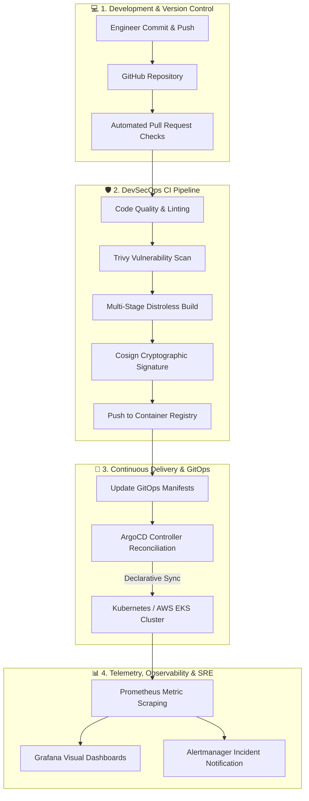

<div align="center">


### ☁️ Cloud & DevOps Engineer | Aspiring SRE & Platform Engineer

*Bridging development and operations by architecting resilient infrastructure, automating CI/CD pipelines, and mastering cloud-native ecosystems.*

<br/>

[](https://www.linkedin.com/in/soham-taralkar/)
[](https://github.com/sohamtaralkar1901)
[](mailto:sohamtaralkar1901@gmail.com)
[](https://hub.docker.com/)

<br/>


</div>

---

> [!NOTE]
> **Engineering Philosophy:** Modern Cloud & DevOps is not just about tools—it is about cultivating rapid feedback loops, immutable infrastructure, automated resilience, and shift-left security. I focus on building rock-solid, production-grade cloud foundations using **Infrastructure as Code**, **GitOps**, and **Kubernetes** to help systems scale reliably.

---

## ⚡ System Information & Terminal Preview

```bash
┌──(soham㉿cloud-workstation)-[~]
└─$ neofetch --devops
```
```yaml
Host:              Soham Taralkar (Cloud & DevOps Engineer)
Operating System:  Linux (Ubuntu / Arch / Debian) · Zsh / Bash
Current Focus:     Multi-Cluster Kubernetes, Terraform Blueprints & GitOps
Cloud Ecosystem:   Amazon Web Services (AWS Primary) · GCP · Hybrid Bare-Metal
Daily Stack:       Linux · Docker · Kubernetes · Terraform · Helm · ArgoCD
CI/CD Engines:     GitHub Actions · ArgoCD · GitLab CI · Jenkins
Observability:     Prometheus · Grafana · OpenTelemetry · Loki · Alertmanager
DevSecOps:         Trivy · SonarQube · HashiCorp Vault · Infracost · Cosign
Core Motto:        "Automate everything, observe continuously, fail gracefully."
Status:            Actively seeking Cloud / DevOps / SRE Roles & Opportunities 🚀
```

---

## 🧠 Continuous Learning & Competency Tracker

Here is a structured, real-time snapshot of my active upskilling roadmap across Cloud, DevOps, and Platform Engineering:

| Domain | Core Focus Areas | Proficiency | Target / Status |
|:-------|:-----------------|:-----------:|:---------------:|
| 🐧 **Linux & Networking** | Bash Scripting, Systemd, Process Management, DNS, TCP/IP, IPtables, SSH Hardening | `██████████` 95% | **Solid** |
| 🐳 **Containers & Docker** | Multi-stage Dockerfiles, Distroless Images, Container Networking, Docker Compose | `█████████░` 90% | **Proficient** |
| ⚙️ **CI/CD & Automation** | GitHub Actions Workflows, Reusable Actions, Matrix Builds, Secrets Management | `█████████░` 88% | **Proficient** |
| 🏗️ **Infrastructure as Code** | Terraform Modules, State Management & Locking, Terragrunt, Drift Detection | `████████░░` 80% | **Active Focus** |
| ☸️ **Kubernetes (K8s)** | Pods, Deployments, Services, Ingress, Helm Charts, RBAC, CKA Roadmap | `████████░░` 78% | **Daily Focus** |
| ☁️ **AWS Cloud Architecture** | VPC, EKS, RDS, S3, IAM Least-Privilege, CloudWatch, SAA-C03 Prep | `███████░░░` 75% | **In Progress** |
| 📊 **Observability & SRE** | Prometheus Metric Scraping, Grafana Dashboards, Alertmanager, SLOs & SLIs | `███████░░░` 70% | **Active Focus** |
| 🔄 **GitOps & Mesh** | ArgoCD App-of-Apps Pattern, Canary Rollouts, Istio Service Mesh | `██████░░░░` 62% | **Exploring** |
| 🛡️ **DevSecOps & FinOps** | Trivy Vulnerability Scanning, Infracost Budgeting, HashiCorp Vault Secrets | `██████░░░░` 60% | **Exploring** |

---

## 🛠️ The DevOps Engineer Toolbox

<div align="center">


<br/><br/>

| Domain | Technologies & Tooling |
|:---|:---|
| ☁️ **Cloud Platforms** |    |
| 🐳 **Containers & Orchestration** |    |
| 🏗️ **Infrastructure as Code** |    |
| ⚙️ **CI/CD & GitOps** |      |
| 📊 **Observability & SRE** |     |
| 🛡️ **DevSecOps & FinOps** |     |
| 💻 **Languages & Systems** |          |

</div>

---

## 📐 Cloud Architecture & GitOps Delivery Lifecycle

Below is the standard, production-ready continuous delivery and platform architecture workflow I design and implement:



---

## 🎯 Certifications & Professional Milestones

| Certification / Credential | Issuing Body | Status | Core Domains |
|:---|:---:|:---:|:---|
| **AWS Certified Solutions Architect – Associate (SAA-C03)** | AWS |  `In Final Prep` | Multi-Tier Resilient Architecture, IAM, VPC, S3 |
| **Certified Kubernetes Administrator (CKA)** | CNCF |  `Active Prep` | Cluster Architecture, Networking, Storage, RBAC |
| **HashiCorp Certified: Terraform Associate (003)** | HashiCorp |  `Completed Prep` | State Locking, Reusable Modules, Cloud Backends |
| **Linux Foundation: Cloud Native Practitioner** | Linux Foundation |  `Completed` | Cloud-Native Principles, Container Standards |

---

## 📚 Core Engineering Principles & Bookshelf

> [!TIP]
> Great infrastructure engineering is founded on sound systems thinking, disciplined documentation, and reading foundational literature.

### 🌟 Key Principles
- **Infrastructure as Code (IaC):** Treat infrastructure like software—versioned, tested, peer-reviewed, and automated.
- **Shift-Left DevSecOps:** Integrate vulnerability scanning and compliance checks directly into the commit pipeline.
- **GitOps as Single Source of Truth:** The git repository represents the state of truth; clusters self-heal toward that state.
- **SRE & Golden Signals:** Monitor Latency, Traffic, Errors, and Saturation to maintain reliable customer-facing SLOs.

### 📖 Essential Reading List
- 📘 *The Phoenix Project* & *The DevOps Handbook* — Gene Kim, Jez Humble, Patrick Debois
- 📘 *Site Reliability Engineering: How Google Runs Production Systems* — Google SRE Team
- 📘 *Kubernetes: Up and Running* — Kelsey Hightower, Brendan Burns, Joe Beda
- 📘 *Terraform: Up & Running* — Yevgeniy Brikman
- 📘 *Designing Data-Intensive Applications* — Martin Kleppmann

---

## 📊 Live GitHub Analytics & Contribution Metrics

<div align="center">


<br/><br/>


&nbsp;


<br/><br/>

<a href="https://github.com/sohamtaralkar1901">
  
</a>

</div>

---

## 🤝 Connect, Collaborate & Work Together

<div align="center">

I am always keen to connect with fellow engineers, platform architects, and engineering teams building resilient cloud systems. Whether discussing GitOps workflows, Kubernetes architectures, or exploring DevOps/SRE opportunities—my inbox is always open!

<br/>

[](https://www.linkedin.com/in/soham-taralkar/)
&nbsp;
[](https://github.com/sohamtaralkar1901)
&nbsp;
[](mailto:sohamtaralkar1901@gmail.com)
&nbsp;
[](https://hub.docker.com/)

<br/><br/>

*Open to Junior/Associate DevOps, Cloud Engineering, Platform Engineering roles, internships, and open-source collaborations.*

<br/>

<sub>Crafted with code, containers, and continuous learning · Soham Taralkar</sub>

</div>


